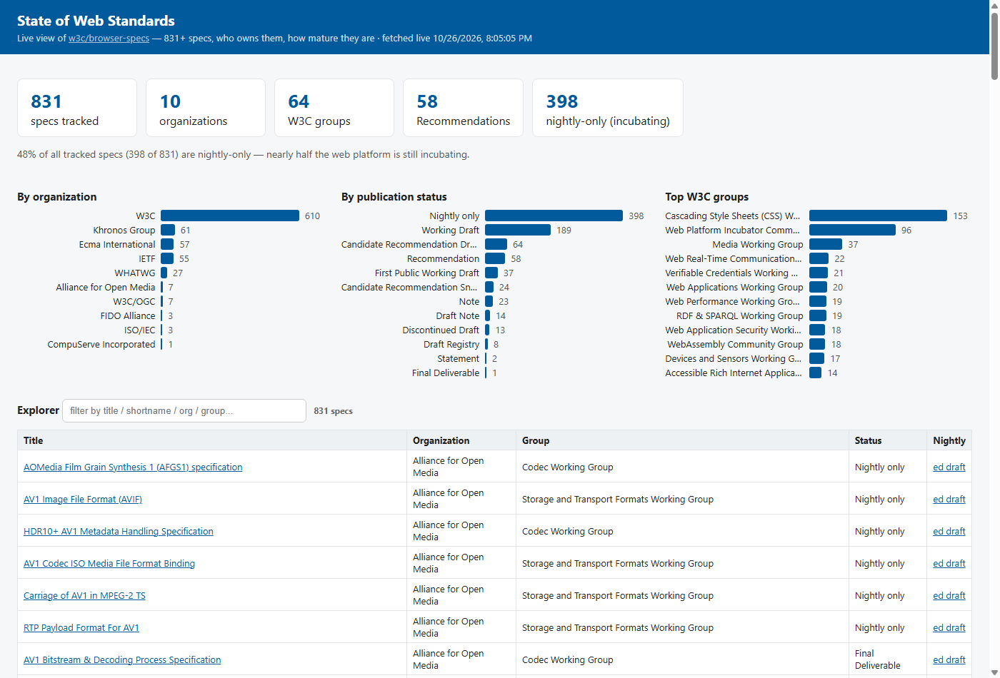

# State of Web Standards

Live dashboard over [w3c/browser-specs](https://github.com/w3c/browser-specs): 800+ specs, who owns them, how mature they are.

**Demo: https://dingjethw.github.io/task1/**



## Use it

- Click any bar (org / status / group) to filter the table; click again or the chip to clear
- Filters are deep-linkable via URL hash, e.g. `/#status=Recommendation`
- Search box filters by title, shortname, org, or group

## 60-second demo

1. Open the live URL — header shows "fetched live &lt;timestamp&gt;" (data is not baked in)
2. Point at the insight line: ~half of all tracked specs are still nightly-only
3. Click the **W3C** bar in "By organization" → table filters, chip appears
4. Open `/#status=Recommendation` in a new tab → deep link lands pre-filtered
5. Mention: every number on the page is recomputed in Python and asserted against a headless-Chrome render, in CI on every push

## Run the test

```
python test_dashboard.py
```

Recomputes every number on the page in Python, renders the page and 3 filtered views in headless Chrome, asserts they match. Runs in CI on every push (GitHub Actions, ubuntu).

No build step, no dependencies — one HTML file, stdlib-only test.
